# Slide to Confirm

A custom card for [Home Assistant](https://www.home-assistant.io) that prevents accidental
actions. Instead of tapping a button, you drag a handle all the way across the card. Nothing
happens until the handle reaches the far end.

Use case: a button that unlocks your front door is one mis-tap away from a door standing open
while you are out. A slide across the full width of your phone is hard to do by accident.

> **v2** is a full rewrite: snake_case options, a visual editor, left-to-right or right-to-left
> sliding, a `style:` block for colors and sizes, entity awareness, keyboard access and a test
> suite. v1 configs keep working unchanged. See [Migrating from v1](#migrating-from-v1).

## Screenshot

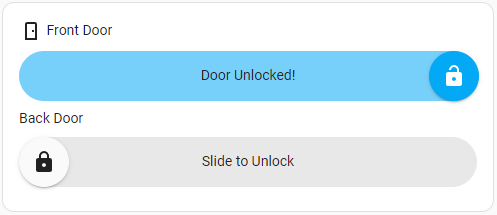

## Screencast

https://github.com/itsbrianburton/slide-confirm/assets/29252421/086edb77-23ae-4556-b6ee-6a4669253dd2

## Installation

Requires Home Assistant 2024.8 or newer.

### HACS (recommended)

1. In HACS, open **Frontend**, then the three-dot menu, then **Custom repositories**.
2. Add `https://github.com/itsbrianburton/slide-confirm` as a **Dashboard** repository.
3. Install **Slide to Confirm** and reload the page when prompted.

### Manual

1. Download `slide-confirm.js` from the latest
   [release](https://github.com/itsbrianburton/slide-confirm/releases).
2. Copy it to `config/www/slide-confirm.js`.
3. Add a dashboard resource: **Settings → Dashboards → ⋮ → Resources → Add resource**, URL
   `/local/slide-confirm.js`, type **JavaScript module**.

## Quick start

Edit a dashboard, click **Add card**, and pick **Slide to Confirm**. The visual editor covers
every option. The same card in YAML:

```yaml
type: custom:slide-confirm-card
sliders:
  - name: Front Door
    icon: mdi:door
    text_unconfirmed: Slide to Unlock
    text_confirmed: Door Unlocked!
    icon_unconfirmed: mdi:lock
    icon_confirmed: mdi:lock-open
    confirm_action:
      action: perform-action
      perform_action: lock.unlock
      target:
        entity_id: lock.front_door
```

## Configuration

### Card options

| Option      | Type                          | Default | Description                                           |
| ----------- | ----------------------------- | ------- | ----------------------------------------------------- |
| `type`      | string                        |         | `custom:slide-confirm-card`                           |
| `header`    | string                        |         | Card title                                            |
| `direction` | `ltr` \| `rtl`                | `ltr`   | Default slide direction for all sliders               |
| `theme`     | [theme](#themes)              |         | Default theme for all sliders                         |
| `style`     | [style object](#style-object) |         | Style defaults for all sliders                        |
| `sliders`   | list                          |         | **Required.** One or more [sliders](#slider-options). |

### Slider options

| Option             | Type                          | Default                                            | Description                                                                                                                        |
| ------------------ | ----------------------------- | -------------------------------------------------- | ---------------------------------------------------------------------------------------------------------------------------------- |
| `confirm_action`   | [action](#confirm_action)     |                                                    | **Required.** What happens after a successful slide.                                                                               |
| `name`             | string                        | entity friendly name                               | Text above the slider                                                                                                              |
| `icon`             | string                        | entity icon                                        | Icon before the name, e.g. `mdi:door`                                                                                              |
| `label`            | string                        |                                                    | Secondary text next to the name                                                                                                    |
| `entity`           | string                        |                                                    | Supplies the default name and icon and enables `disabled_states` and `reset_delay: 0`                                              |
| `text_unconfirmed` | string                        | `Slide to confirm`                                 | Text on the track before confirming                                                                                                |
| `text_confirmed`   | string                        | `Confirmed`                                        | Text on the track after confirming                                                                                                 |
| `icon_unconfirmed` | string                        | `mdi:chevron-right` (`mdi:chevron-left` for `rtl`) | Icon on the handle                                                                                                                 |
| `icon_confirmed`   | string                        | `mdi:check`                                        | Icon on the handle after confirming                                                                                                |
| `direction`        | `ltr` \| `rtl`                | card `direction`                                   | `rtl` puts the handle on the right and requires a right-to-left slide                                                              |
| `reset_delay`      | integer (ms)                  | `1500`                                             | How long the confirmed state is shown. `0` holds it until the entity changes state (needs `entity`), 30 s at most.                 |
| `haptic`           | boolean                       | `false`                                            | Vibrate the device on a successful slide (companion app, or browsers with **Vibrate** enabled in the user profile)                 |
| `snap`             | boolean                       | `false`                                            | Near the end the handle snaps in like a latch, with a short haptic tap; release to confirm, pull back to let go. See [Snap](#snap) |
| `snap_distance`    | integer (px)                  | 1.4 × handle size                                  | How far before the end the handle snaps in                                                                                         |
| `theme`            | [theme](#themes)              | card `theme`                                       | One of the built-in looks                                                                                                          |
| `disabled_states`  | string or list                |                                                    | Grey out and disable the slider while `entity` is in one of these states                                                           |
| `style`            | [style object](#style-object) |                                                    | Style overrides for this slider                                                                                                    |

### `confirm_action`

The same action object Home Assistant uses for `tap_action` everywhere else, so you can copy
examples from the HA docs and edit it with HA's action picker:

```yaml
confirm_action:
  action: perform-action
  perform_action: cover.set_cover_position
  target:
    entity_id: cover.garage
  data:
    position: 10
```

Supported actions: `perform-action`, `toggle`, `more-info`, `navigate`, `url`, `assist`,
`fire-dom-event`, `none`. `toggle` and `more-info` act on the slider's `entity`. The card hands
the action to Home Assistant to run, so HA's own target handling, error toasts and
confirmation dialogs apply.

The v1 shape (`action: call-service` with `service:`) and the Developer Tools shape
(`action: lock.unlock` with `target:`) are still accepted.

### Style object

Colors and sizes without card_mod. Every key maps to a CSS custom property you can also set
from a theme. Bare numbers on size keys mean pixels.

| Key                    | CSS property                           | Default                               |
| ---------------------- | -------------------------------------- | ------------------------------------- |
| `handle_size`          | `--slide-confirm-handle-size`          | `50px`                                |
| `track_height`         | `--slide-confirm-track-height`         | handle size                           |
| `border_radius`        | `--slide-confirm-border-radius`        | half the handle size                  |
| `font_size`            | `--slide-confirm-font-size`            | `1rem`                                |
| `track_color`          | `--slide-confirm-track-color`          | `--slider-track-color` (shown at 38%) |
| `handle_color`         | `--slide-confirm-handle-color`         | `--card-background-color`             |
| `handle_border_color`  | `--slide-confirm-handle-border-color`  | `--divider-color`                     |
| `text_color`           | `--slide-confirm-text-color`           | `--primary-text-color`                |
| `confirmed_color`      | `--slide-confirm-confirmed-color`      | `--primary-color`                     |
| `confirmed_text_color` | `--slide-confirm-confirmed-text-color` | `--text-primary-color`                |
| `fill_opacity`         | `--slide-confirm-fill-opacity`         | `0.54`                                |

```yaml
type: custom:slide-confirm-card
style:
  handle_size: 40
  font_size: 0.9rem
sliders:
  - name: Shutdown PC
    confirm_action:
      {
        action: perform-action,
        perform_action: button.press,
        target: { entity_id: button.pc_shutdown },
      }
    style:
      confirmed_color: var(--error-color)
```

### CSS parts (card_mod)

For anything the style object does not cover, the slider exposes CSS shadow parts: `slider`,
`header`, `icon`, `name`, `label`, `track`, `fill`, `text`, `handle`.

```yaml
type: custom:slide-confirm-card
card_mod:
  style:
    slide-confirm-slider$: |
      [part="handle"] { box-shadow: none; }
      [part="text"] { font-weight: 600; letter-spacing: 0.02em; }
sliders: ...
```

## Snap

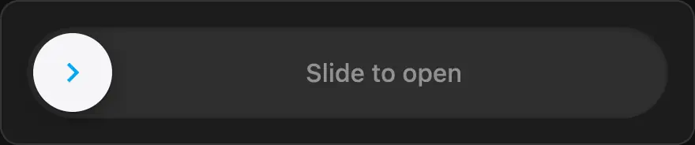

With `snap: true` the slider behaves like a physical latch:

- The handle tracks your finger exactly until it is within `snap_distance` of the end.
- Then it springs to the end and hits it with a small bounce. The haptic tap (`light`, the
  keyboard tap on Android) fires at the moment of impact.
- While snapped it gives a little if you pull back. Pull back further and it lets go, with
  another tap, and follows your finger again.
- Releasing while snapped confirms; releasing anywhere else springs the handle back.

Every movement (snapping, letting go, returning) is a spring that carries your finger's speed,
and the prompt text fades out as the handle moves over it. Haptics need `haptic: true`.

```yaml
type: custom:slide-confirm-card
sliders:
  - name: Garage door
    snap: true
    haptic: true
    theme: ios
    confirm_action:
      action: perform-action
      perform_action: cover.toggle
      target:
        entity_id: cover.garage_door
```

## Themes

`theme` picks a built-in look, per card or per slider. Each theme still uses your Home Assistant
theme's accent color (`--primary-color`, or `confirmed_color` from the [style object](#style-object))
unless it has its own palette. Leaving `theme` out keeps the classic look.

Shown at rest, while sliding and snapped, and in motion (with `snap: true`):

| Theme     | Preview                                                       | In motion                                                               |
| --------- | ------------------------------------------------------------- | ----------------------------------------------------------------------- |
| `ios`     | 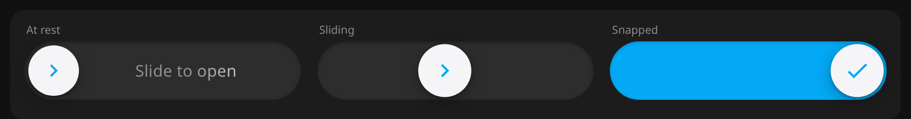         |          |
| `minimal` | 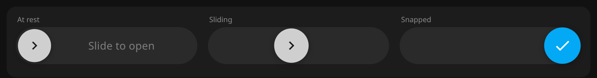 | 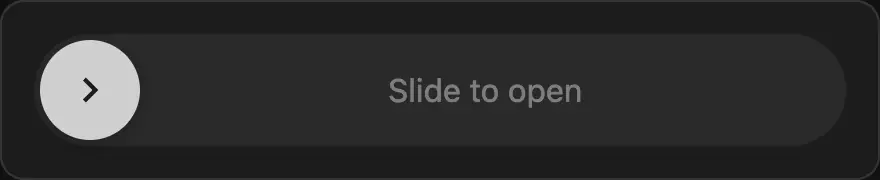 |
| `glow`    | 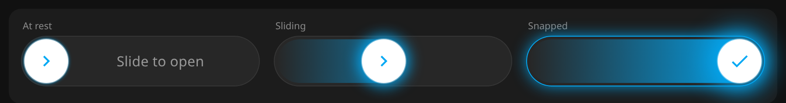       | 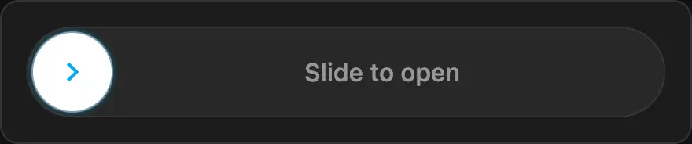       |
| `glass`   | 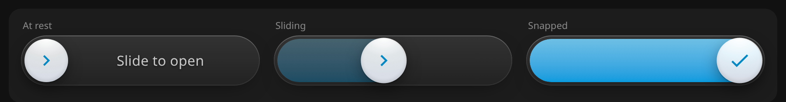     | 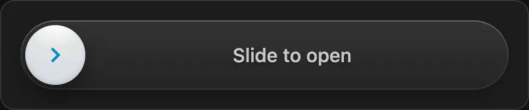     |
| `tonal`   | 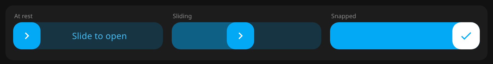     | 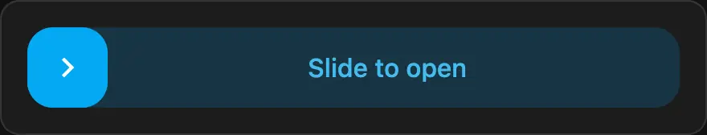     |
| `sunrise` | 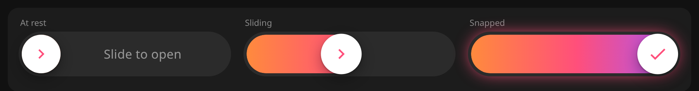 | 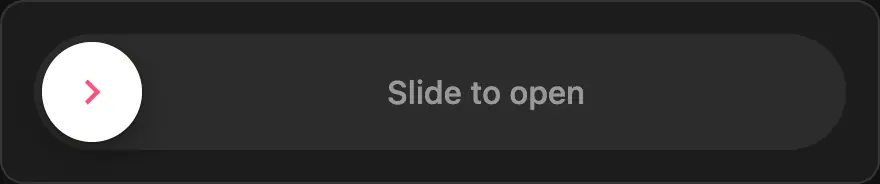 |
| `outline` | 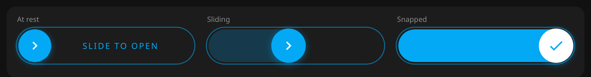 | 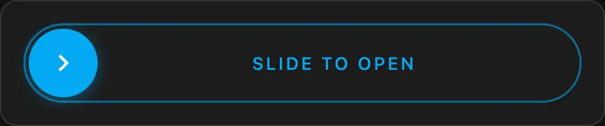 |
| `soft`    | 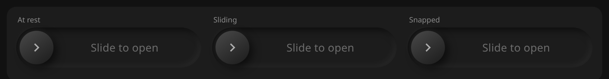       |        |
| `arrows`  | 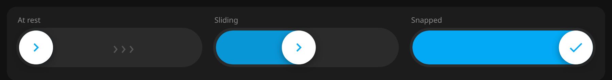   | 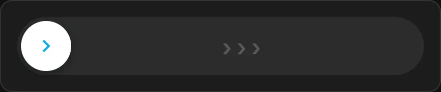   |
| `mono`    | 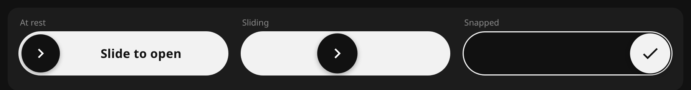       | 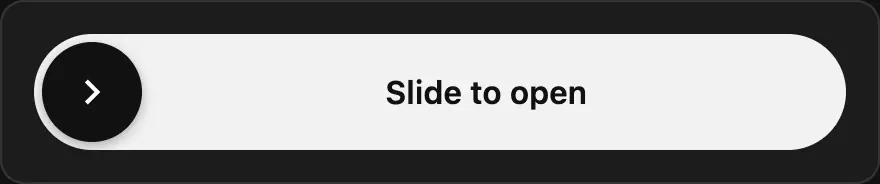       |
| `hazard`  | 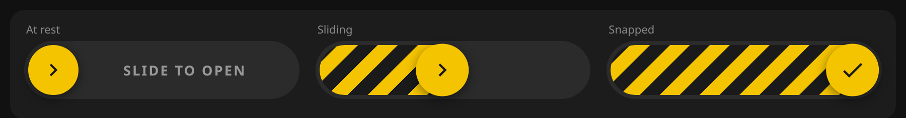   | 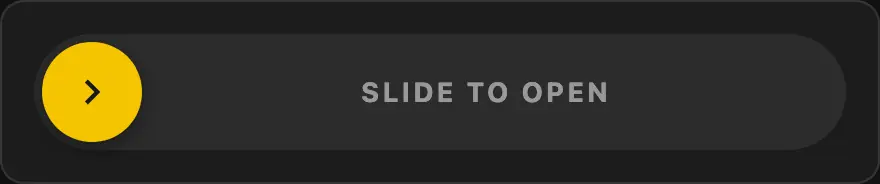   |
| `aurora`  | 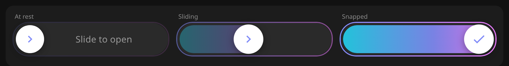   | 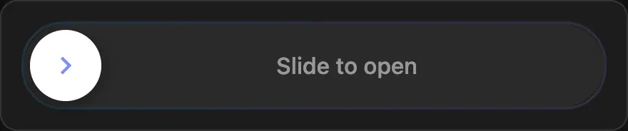   |

Themes inset the handle in the track, so `track_height` is ignored; the color options of the
style object still apply where a theme uses them.

## Examples

### Lock that shows its state

The slider takes its name and icon from the lock, is disabled while the door is already
unlocked, and stays in the confirmed position until the lock reports the new state (useful for
locks that take a few seconds).

```yaml
type: custom:slide-confirm-card
sliders:
  - entity: lock.front_door
    text_unconfirmed: Slide to Unlock
    text_confirmed: Unlocking…
    icon_unconfirmed: mdi:lock
    icon_confirmed: mdi:lock-open
    disabled_states: [unlocked, unlocking, unavailable]
    reset_delay: 0
    haptic: true
    confirm_action:
      action: perform-action
      perform_action: lock.unlock
      target:
        entity_id: lock.front_door
```

### Two directions in one card

```yaml
type: custom:slide-confirm-card
header: Garage
sliders:
  - name: Open
    direction: ltr
    confirm_action:
      {
        action: perform-action,
        perform_action: cover.open_cover,
        target: { entity_id: cover.garage },
      }
  - name: Close
    direction: rtl
    confirm_action:
      {
        action: perform-action,
        perform_action: cover.close_cover,
        target: { entity_id: cover.garage },
      }
```

### Scripts, scenes and anything else

```yaml
type: custom:slide-confirm-card
sliders:
  - name: Movie night
    icon: mdi:movie-open
    text_unconfirmed: Slide to start
    text_confirmed: Enjoy!
    confirm_action:
      action: perform-action
      perform_action: scene.turn_on
      target:
        scene: scene.movie_night
  - name: Restart Home Assistant
    icon: mdi:restart
    text_unconfirmed: Slide to restart
    text_confirmed: Restarting…
    confirm_action:
      action: perform-action
      perform_action: homeassistant.restart
    style:
      confirmed_color: var(--error-color)
```

## Behaviour

- **Confirming** requires releasing the handle at the far end (within 2 px), or anywhere while
  it is snapped with [`snap`](#snap). Releasing earlier springs it back without doing anything.
- **Keyboard**: focus the handle and press the arrow keys. Each press moves 10%, so confirming
  takes ten presses. Home resets. There is no shortcut that jumps to the end.
- **Disabled** sliders (via `disabled_states`) are greyed out and ignore input.
- **Config notes**, such as deprecated v1 option names, are printed once to the browser console.
- **Sections dashboards**: the card is full width by default and can be shrunk to half a
  section in the layout editor.

## Migrating from v1

v1 configs work unchanged; the card maps them in memory and logs a note in the console. The
visual editor shows an **Upgrade** button that rewrites the option names in place. Changes:

| v1                                             | v2                                               |
| ---------------------------------------------- | ------------------------------------------------ |
| `textUnconfirmed` / `textConfirmed`            | `text_unconfirmed` / `text_confirmed`            |
| `iconUnconfirmed` / `iconConfirmed`            | `icon_unconfirmed` / `icon_confirmed`            |
| `confirm_action.action: call-service`          | `action: perform-action`                         |
| `confirm_action.service: lock.unlock`          | `perform_action: lock.unlock`                    |
| `--switch-*` theme variables, `--text-color`   | `--slide-confirm-*` properties with HA fallbacks |
| card_mod selectors `.slide-confirm-track` etc. | CSS parts: `[part="track"]` etc.                 |

Details, including behaviour differences, are in
[docs/migration-v1-to-v2.md](docs/migration-v1-to-v2.md).

## Development

```bash
npm install
npm run demo      # standalone demo page with a fake Home Assistant
npm test          # unit tests (Node) and component tests (Chromium via Playwright)
npm run check     # lint, format, typecheck, test, build
npm run build     # dist/slide-confirm.js (not committed; releases attach it)
```

Releases are cut from a tag by GitHub Actions; see [docs/releasing.md](docs/releasing.md).

The component tests need a Chromium build: `npx playwright install chromium` once.

The design and work plan for v2 is in [docs/v2-plan.md](docs/v2-plan.md).

## Contributing

Issues and pull requests are welcome. Please run `npm run check` before opening a PR.

## License

[MIT](LICENSE)
